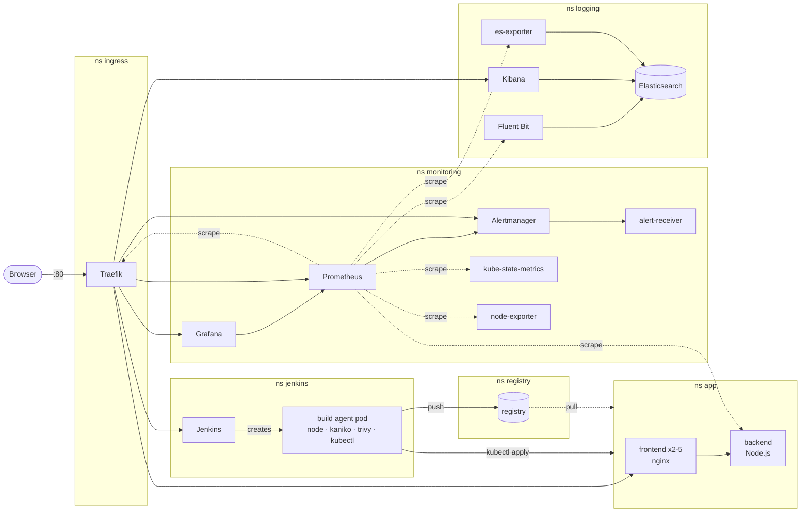

# Cluster Chronicles

The **infra-insight** app (a Node.js API and a React dashboard) and everything around it —
image registry, CI/CD, monitoring, logging and alerting — moved from seven virtual machines
to a **Kubernetes** cluster (Minikube). Every piece is plain Kubernetes manifests: no Helm,
no operators, nothing configured by hand.

| | |
|---|---|
| **App** | backend (1 replica) + frontend (2 replicas, autoscaled to 5) behind a Traefik ingress |
| **CI/CD** | Jenkins in the cluster; each build is a pod: test → Kaniko build → Trivy scan → deploy → smoke test |
| **Monitoring** | Prometheus, Alertmanager, Grafana (3 dashboards), kube-state-metrics, node-exporter |
| **Logging** | EFK: Elasticsearch, Fluent Bit (container, node and event logs), Kibana (3 dashboards) |
| **Alerting** | 12 Prometheus rules → Alertmanager → webhook receiver (optionally Slack / Discord) |
| **Storage** | administrator-provisioned PersistentVolumes for the registry, Jenkins, Trivy, Prometheus, Grafana, Elasticsearch |
| **Security** | Pod Security Admission per namespace, non-root read-only containers, least-privilege RBAC, Secrets, NetworkPolicies |

---

## Quick start

**Requirements**

- [VirtualBox](https://www.virtualbox.org/) 7.x, [Minikube](https://minikube.sigs.k8s.io/) 1.38+,
  [kubectl](https://kubernetes.io/docs/tasks/tools/) 1.34+
- bash — on Windows use Git Bash
- ~8 GB free RAM (the VM gets 7 GB), ~25 GB free disk, internet access

```bash
git clone https://github.com/spamook/automation-alchemy.git
cd automation-alchemy

scripts/cluster-up.sh    # creates the Minikube VM (~5 min the first time)
scripts/deploy.sh        # builds the bootstrap images, applies everything (~15 min the first time)
scripts/verify.sh        # checks every part end to end
scripts/info.sh          # prints the URLs and logins again
```

Everything is reachable on the Minikube IP (`minikube ip`, e.g. `192.168.56.101`):

| URL | What | Login |
|---|---|---|
| `http://<ip>/` | the app | – |
| `http://<ip>/jenkins/` | Jenkins | `admin` |
| `http://<ip>/grafana/` | Grafana | `admin` |
| `http://<ip>/kibana/` | Kibana | `elastic` |
| `http://<ip>/prometheus/` | Prometheus | `ops` (basic auth at the ingress) |
| `http://<ip>/alertmanager/` | Alertmanager | `ops` (basic auth at the ingress) |

Passwords are generated on the first deploy into `.secrets/credentials.env` (ignored by git)
and stored in the cluster as Kubernetes Secrets; `scripts/info.sh` prints them.

Right after the deploy Jenkins finds no previous build, so its first SCM poll starts the
pipeline on its own: about five minutes later the app runs images built by the pipeline.

---

## Architecture



| Namespace | Pod Security level | Contents |
|---|---|---|
| `app` | restricted | backend, frontend, HPA, PodDisruptionBudget |
| `registry` | restricted | private image registry (fixed ClusterIP `10.96.0.50`) |
| `ingress` | privileged (hostPort 80) | Traefik ingress controller |
| `jenkins` | baseline (Kaniko runs as root) | Jenkins controller and its build agent pods |
| `monitoring` | privileged (node-exporter reads the host) | Prometheus, Alertmanager, alert-receiver, Grafana, kube-state-metrics, node-exporter |
| `logging` | privileged (Fluent Bit reads node log files) | Elasticsearch, Fluent Bit, Kibana, elasticsearch-exporter |

Routing is by path on one address, so no DNS or hosts-file entries are needed: Traefik sends
`/jenkins`, `/grafana`, `/kibana`, `/prometheus` and `/alertmanager` to the tools (each runs
with that path as its base URL) and everything else to the frontend.

---

## Project structure

```
.
├── backend/                  Node.js API (Express, prom-client, JSON logs)
├── frontend/                 React dashboard, served by unprivileged nginx
├── manifests/                everything that runs in the cluster (kubectl apply -k manifests)
│   ├── namespaces/           namespaces + Pod Security labels, LimitRanges, ResourceQuotas
│   ├── storage/              StorageClass and PersistentVolumes
│   ├── registry/             private image registry + its PVC
│   ├── ingress/              Traefik: RBAC, IngressClass, basic-auth middleware
│   ├── backend/              Deployment, Service, ConfigMap
│   ├── frontend/             Deployment, Service, Ingress, HPA, PodDisruptionBudget
│   ├── cicd/                 Jenkins: RBAC, PVCs, Configuration as Code, Deployment, Ingress
│   ├── monitoring/           prometheus/, alertmanager/, alert-receiver/, grafana/,
│   │                         kube-state-metrics/, node-exporter/
│   └── logging/              elasticsearch/, fluent-bit/, kibana/, es-exporter/
├── cicd/
│   ├── Jenkinsfile           the pipeline
│   ├── agent-pod.yaml        pod template of the build agents
│   ├── jenkins/              Jenkins image with its plugins
│   └── tools/                kubectl + curl image for deploy and smoke test
├── security/
│   ├── README.md             security measures and where they live
│   └── network-policies/     optional NetworkPolicies (bonus)
├── scripts/                  cluster-up, deploy, verify, load test, alert simulation, ...
└── docs/
    └── DESIGN.md             design decisions and the problems met on the way
```

Every component directory is a [Kustomize](https://kustomize.io/) base (built into kubectl):
configuration files live next to the manifests and are turned into ConfigMaps with a hash
suffix, so changing e.g. `prometheus.yml` and re-applying restarts Prometheus automatically.

---

## Application

| | backend | frontend |
|---|---|---|
| Replicas | 1 | 2 (HPA: 2–5 at 50% CPU) |
| Image | `10.96.0.50/backend:<tag>` | `10.96.0.50/frontend:<tag>` |
| Port | 3001 | 8080 (nginx-unprivileged) |
| Requests / limits | 50m, 96Mi / 500m, 256Mi | 50m, 32Mi / 250m, 96Mi |
| Probes | `GET /health` | `GET /healthz` |
| Config | ConfigMap `backend-config` | ConfigMap `frontend-config` (backend address) |
| Runs as | uid 1000, read-only root FS | uid 101, read-only root FS |

- **Internal communication**: the frontend's nginx proxies `/api/` to the backend's Service
  (`backend.app.svc.cluster.local:3001`); the address comes from a ConfigMap.
- **Load balancing**: the `frontend` Service spreads traffic over every ready replica, Traefik
  balances requests over the same endpoints. Every response carries `X-Served-By: <pod>`:

  ```bash
  for i in $(seq 6); do curl -sI http://$(minikube ip)/ | grep X-Served-By; done
  ```

- **External access**: Ingress `frontend` (`/`) on the Traefik ingress controller, which binds
  port 80 of the node.
- **Metrics**: the backend exposes Prometheus metrics on `/prometheus`, including the custom
  counter `infra_metrics_served_total` and a request-duration histogram.

## Persistent storage

`manifests/storage/` holds a `local-storage` StorageClass without a provisioner and one
PersistentVolume per stateful component — storage *provisioned by an administrator*. Each
volume is a directory under `/data` on the Minikube node (Minikube keeps `/data` across
restarts; `scripts/cluster-up.sh` creates the directories owned by the user each app runs
as). `claimRef` binds every volume to exactly one claim:

| PersistentVolume | Claim | Used by |
|---|---|---|
| `registry-data` 5Gi | `registry/registry-data` | pushed images |
| `jenkins-home` 5Gi | `jenkins/jenkins-home` | jobs, build history, archived Trivy reports |
| `trivy-cache` 2Gi | `jenkins/trivy-cache` | Trivy's vulnerability database, shared by build agents |
| `prometheus-data` 5Gi | `monitoring/prometheus-data` | metrics (7 days / 4 GB) |
| `grafana-data` 1Gi | `monitoring/grafana-data` | users, preferences, annotations |
| `elasticsearch-data` 10Gi | `logging/data-elasticsearch-0` | log indices (deleted after 7 days) |

```bash
kubectl get pv,pvc -A                  # everything Bound
kubectl -n jenkins delete pod -l app.kubernetes.io/name=jenkins   # history survives the restart
```

## CI/CD pipeline

Jenkins runs in the `jenkins` namespace, fully configured by
[Configuration as Code](manifests/cicd/jenkins-casc.yaml): admin user from a Secret, the
Kubernetes cloud, and the `infra-insight` pipeline job, which polls this repository every two
minutes. The controller has no executors: every build runs in a fresh agent pod
([cicd/agent-pod.yaml](cicd/agent-pod.yaml)) that is deleted afterwards.

| Stage | Container | What happens |
|---|---|---|
| Test | `node` | `npm ci`, TypeScript build of the backend, lint + build of the frontend |
| Build images | `kaniko` | builds both Dockerfiles without a Docker daemon, pushes `10.96.0.50/<app>:<build>-<commit>` (layer cache in the registry) |
| Scan images | `trivy` | report of HIGH + CRITICAL findings (archived with the build); **any CRITICAL vulnerability fails the build before deploy** |
| Deploy | `tools` | `kubectl apply -k` of the app manifests with the new tags, waits for the rollout |
| Smoke test | `tools` | UI, `/api/health`, `/api/metrics` and the backend's metrics endpoint inside the cluster; on failure both deployments are rolled back |

**Permissions** ([manifests/cicd/rbac.yaml](manifests/cicd/rbac.yaml)): the controller's
ServiceAccount may only manage pods in `jenkins`; the agents run as `jenkins-deployer`, which
may update the app's Deployments, Services, ConfigMaps, Ingress, HPA and PDB in `app` — no
Secrets, no deletes, no other namespace.

```bash
# trigger: push a commit (picked up within 2 minutes), or "Build Now" in Jenkins
kubectl -n jenkins get pods -w                      # the agent pod appears and goes away
kubectl -n app get deploy -o wide                   # images now carry the new build tag
```

Building from a fork: point `GIT_REPO_URL` in
[manifests/cicd/kustomization.yaml](manifests/cicd/kustomization.yaml) at it and re-apply.

The scan gate is not theoretical: the first run on this cluster failed on CVE-2026-90711 in
`proxy-addr` (a dependency of Express) and the second on CVE-2026-111497 in Alpine's
`brotli-libs`; both were fixed in the repository before anything was deployed.

## Monitoring

Prometheus discovers its targets through the Kubernetes API, so new pods are picked up
automatically ([prometheus.yml](manifests/monitoring/prometheus/prometheus.yml)):

| Job | Source |
|---|---|
| `apiserver` | the Kubernetes API server |
| `kubelet`, `cadvisor` | each node's kubelet: CPU, memory and network of every container |
| `node-exporter` | the node itself: CPU, memory, disk, network, load |
| `kube-state-metrics` | object state: pod phases, restarts, requests/limits, replicas, HPA |
| `kubernetes-pods` | every pod annotated `prometheus.io/scrape: "true"` — backend, Traefik, Fluent Bit, elasticsearch-exporter, Alertmanager |

Grafana dashboards (folder *Kubernetes*, provisioned from
[manifests/monitoring/grafana/dashboards](manifests/monitoring/grafana/dashboards)):

- **Cluster Performance** — nodes ready, pods by phase, API server status, firing alerts;
  node CPU / memory / disk / network / load with the alert thresholds drawn in; CPU and
  memory requested vs allocatable; usage per namespace; deployments.
- **Pods & Containers** — per namespace and pod: CPU, CPU throttling, memory and memory vs
  limit, restarts, pod status, containers not running (CrashLoopBackOff, ...), network in/out,
  requests and limits.
- **Application Performance** — backend request rate, status codes, 5xx rate, p50/p95/p99
  latency; frontend traffic, latency and error rate measured at the ingress; frontend CPU and
  replicas (HPA); the custom metric; Node.js heap, event-loop lag and CPU.

## Logging

```
container stdout/stderr ─┐
journald (kubelet, ...) ─┼─> Fluent Bit (DaemonSet) ─> Elasticsearch ─> Kibana
Kubernetes events ───────┘     + pod / namespace / labels
```

Fluent Bit ([fluent-bit.yaml](manifests/logging/fluent-bit/fluent-bit.yaml)) reads three
sources on every node, adds Kubernetes metadata, and parses the JSON logs of the app
(`level`, `status`, `path`, `durationMs` from the backend; nginx access log fields from the
frontend). Everything goes to daily indices `k8s-logs-YYYY.MM.DD`; the field `log_source`
(`container` / `node` / `event`) tells them apart. An index template keeps them at 0 replicas
(single node → status green) and a lifecycle policy deletes them after 7 days.

Elasticsearch runs with security on: Kibana, Fluent Bit and the exporter have their own users
with only the privileges they need (created by a setup Job).

Kibana dashboards (imported by a Job, default data view *Kubernetes logs*):

- **Cluster Logs** — node services (journald), Kubernetes events by reason, warning events,
  control-plane components in `kube-system`.
- **Application Logs** — backend log levels, HTTP status codes, response times, top paths,
  errors & warnings, access log.
- **Pod & Container Logs** — log volume per namespace and pod, stdout vs stderr per container,
  stderr over time, latest lines with pod / container / stream.

## Alerting

[Rules](manifests/monitoring/prometheus/alerts.yaml) are evaluated by Prometheus; firing
alerts go to [Alertmanager](manifests/monitoring/alertmanager/alertmanager.yml), which groups
them and posts them to the in-cluster **alert-receiver**. It prints one line per alert
(`kubectl -n monitoring logs -f deploy/alert-receiver` — and Kibana) and forwards it to a
Slack-compatible webhook if `ALERT_WEBHOOK_URL` is set in `.secrets/credentials.env`.

| Alert | Condition |
|---|---|
| `NodeHighCPU` | node CPU > 80% for 5 min |
| `NodeLowDiskSpace` | < 20% free on a node disk |
| `NodeHighMemory` | node memory > 90% for 5 min |
| `PodRestartingTooOften` | > 3 container restarts in 15 min |
| `ContainerMemoryNearLimit` | working set > 80% of the memory limit |
| `PodPendingTooLong` | pod Pending for > 5 min |
| `KubeAPIServerDown` | API server not scrapable for 1 min |
| `ElasticsearchClusterYellow` / `ElasticsearchClusterRed` | cluster health yellow / red |
| `ElasticsearchUnreachable` | the exporter can't reach Elasticsearch |
| `FluentBitOutputErrors` | Fluent Bit's output errors, dropped chunks or ongoing retries |
| `FluentBitDown` | a Fluent Bit pod can't be scraped |

Each alert can be triggered on purpose:

```bash
scripts/simulate-alerts.sh                # list of scenarios
scripts/simulate-alerts.sh pod-restarts   # prints the alert going inactive -> pending -> firing
kubectl -n monitoring logs -f deploy/alert-receiver
```

## Autoscaling

The frontend has a HorizontalPodAutoscaler (CPU target 50% of the request, 2–5 replicas,
scale-down after one quiet minute). metrics-server provides the CPU numbers.

```bash
scripts/load-test.sh          # 3 min of load through the ingress; prints CPU and replicas
```

```
00:23:08  cpu  226% of request (target 50%)   replicas 5 -> 5   load: Succeeded
00:24:58  cpu    2% of request (target 50%)   replicas 5 -> 5   load: Succeeded
00:25:45  cpu    2% of request (target 50%)   replicas 5 -> 4   load: Succeeded
00:26:48  cpu    2% of request (target 50%)   replicas 3 -> 2   load: Succeeded
Code 200 : 314744 (100.0 %)
All done 314744 calls (plus 32 warmup) 9.150 ms avg, 3497.0 qps
```

## Security

See [security/README.md](security/README.md) for the full list. In short:

- **Pod Security Admission** labels on every namespace (`restricted` where possible)
- every container: non-root, no privilege escalation, all capabilities dropped,
  `RuntimeDefault` seccomp, read-only root filesystem wherever the app allows it
- **resources** on every container, LimitRange defaults and ResourceQuotas
- **RBAC**: one ServiceAccount per component with only the verbs it needs;
  `automountServiceAccountToken: false` where the API isn't used
- **Secrets** for every password, generated per installation, never in git
- images: pinned versions, scanned by Trivy before every deploy
- Prometheus and Alertmanager have no login of their own → basic auth at the ingress
- optional **NetworkPolicies** (default deny + explicit allow rules)

## Bonus features

- **NetworkPolicies** (Calico enforces them): `kubectl apply -k security/network-policies`
  — default-deny ingress in every namespace plus the exact flows the platform needs
  (undo with `kubectl delete -k security/network-policies`).
- **Automatic rollback**: a failed smoke test rolls the app back with `kubectl rollout undo`.
- **Alert forwarding** to Slack / Discord: set `ALERT_WEBHOOK_URL`, run `scripts/deploy.sh`.
- **Alert simulation** for every rule: `scripts/simulate-alerts.sh`.
- **One-command health check**: `scripts/verify.sh`.
- **Ingress basic auth** for Prometheus and Alertmanager (Traefik middleware, users from a Secret).

## Usage guide

```bash
kubectl get pods -A                                    # everything
kubectl -n app get deploy,svc,ingress,hpa
kubectl -n app logs deploy/backend -f
kubectl -n app describe pod <pod>                      # events: scheduling, probes, image pulls
kubectl -n app rollout history deployment/frontend
kubectl -n app rollout undo deployment/frontend        # back to the previous version
kubectl top pods -A                                    # CPU / memory (metrics-server)
kubectl apply -k manifests/monitoring                  # re-apply one part after a change
minikube ssh                                           # shell on the node
```

Re-running `scripts/deploy.sh` is safe: it keeps the image tags the pipeline deployed last.
To start over: `minikube delete`, then `scripts/cluster-up.sh` and `scripts/deploy.sh`
(passwords in `.secrets/` are reused).

## Troubleshooting

| Problem | Fix |
|---|---|
| `minikube start` hangs creating a host-only network on Windows | `scripts/cluster-up.sh` reuses VirtualBox's existing `192.168.56.1/24` network; creating a new one needs admin rights |
| VirtualBox VM very slow on Windows | turn the Windows hypervisor off (`bcdedit /set hypervisorlaunchtype off`, reboot); otherwise VirtualBox runs on top of Hyper-V |
| Pods `Pending` with *Insufficient memory* | give the VM more RAM: `MINIKUBE_MEMORY=8000 scripts/cluster-up.sh` on a fresh cluster |
| `ImagePullBackOff` on `10.96.0.50/...` | run `scripts/cluster-up.sh` again: it rewrites the node's registry config, which lives in RAM |
| kubectl warns about version skew | the cluster runs Kubernetes 1.35; use kubectl 1.34–1.36 |
| HPA shows `cpu: <unknown>` right after a deploy | metrics-server needs a minute or two to collect the new pods' CPU; it fills in by itself |
| Kibana restarts with *heap out of memory* | its first start (saved object migrations) needs more than a 512 MB heap; the manifest gives it 768 MB |

## History

Until this migration the project ran on seven Vagrant + Ansible virtual machines (load
balancer, two web servers, app server, backup server, Jenkins, monitoring). That version is
kept under the tag [`vm-infrastructure`](../../tree/vm-infrastructure).

Design decisions and the problems met during the migration are described in
[docs/DESIGN.md](docs/DESIGN.md).
